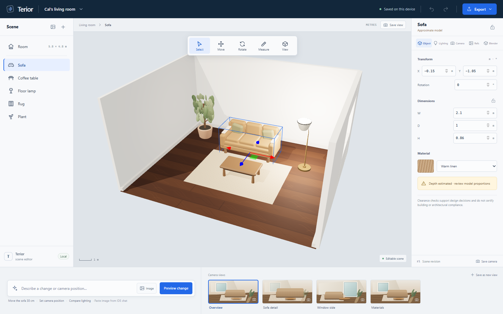

# Terior

Terior is an editable interior design and visualisation studio prototype. It keeps room geometry, furniture identity, measurements, materials, lighting, saved cameras, reference images and Blender build records in one local project. The first workspace opens on a furnished living room with numeric editing, scene selection, transform handles, revision-aware change proposals and repeatable project, PNG and GLB export.



## Run locally

```powershell
npm install
npm run dev
```

Build the web app with `npm run build:web`. Build the Windows Electron installer with `npm run package:win`; the installer is written to `release/`. `npm run package:dir` produces an unpacked Windows app for inspection.

The current portable desktop output is `release/win-unpacked/Terior.exe`. Keep the complete `win-unpacked` folder together when launching or sharing it; Electron loads the editor from `resources/app` and its built `dist` directory.

## Project files and storage

- The working project autosaves in this browser's local storage.
- **Save project** downloads an editable `.terior` JSON file. **Open project** restores it.
- **Export PNG** captures the current view. **Export GLB** exports the editable room geometry, visible objects and named saved camera views.
- Camera positions and aim points are editable and saved with the project. A local prompt previewer demonstrates object, camera and lighting proposals; it does not call an AI service.
- Paste or drop images from an IDE chat into the scene as labelled 2D reference planes. They remain distinct from editable 3D assets.
- `mcp-server/server.mjs` exposes Terior scene read and revision-checked proposal tools to compatible IDE/CLI MCP clients. Run `npm run mcp -- --project "C:\\path\\to\\room.terior"` from this checkout; this source bridge is not bundled into the Electron runtime. The client owns chat image attachment; Terior stores a proposal and waits for a person to apply or reject it. Editor autosaves compare the full file snapshot as well as the scene revision, so a same-revision MCP proposal is detected instead of silently replaced by a stale save.
- The **Blender** panel includes an embedded Windows PowerShell manager for `uv`, MCP for Blender setup and updates, Codex/Claude Code registration and status checks. Its client entries set `BLENDER_MCP_SAFE_MODE=1` and `DISABLE_TELEMETRY=true`. Other MCP clients can use a standard stdio config.
- Blender build records are saved in the `.terior` project. A build starts with a revisioned GLB handoff; import it in Blender and track the `.blend` file location and review status in Terior.
- The Electron runtime ships the bundled editor and does not need React, Three.js or the source MCP bridge installed beside it. The MCP bridge runs from a project checkout where its development dependencies are installed.

## Model provenance

Thirty-eight GLB models and the available JPEG previews were copied from `Storytellr/reference/wonderunit-storyboarder/src/data/shot-generator/objects`. The original Storytellr checkout was not modified. `public/assets/models/storytellr/manifest.json` records each copied filename, source path and source SHA-256. The project uses selected models from that source for the initial room and the add-object library.

## Example outputs

`examples/` contains one editable `.terior` room project, its exported GLB scene and a clean PNG render from the saved sofa-detail camera.

## Blender integration boundary

The scene editor uses a standalone Three.js runtime and does not require Blender for ordinary room editing. Blender is an optional specialist handoff. GLB transfers the supported room, visible objects, materials and cameras; Blender-only data may be lost on transfer. Terior does not promise exact `.blend` round-tripping, and its build log is a status record rather than a Blender build daemon.

The default app includes procedural high-detail furniture assets alongside 38 reused Storytellr GLBs. The copied models and previews retain their source paths and hashes in `public/assets/models/storytellr/manifest.json`. Storytellr's `StageRenderer` itself remains coupled to Storytellr's own scene types and has not been extracted.

MCP for Blender is a third-party project and is not affiliated with the Blender Foundation. The setup wizard can change IDE MCP configuration and Blender add-on files; it runs inside Terior's console, and the user can review its prompts and output. That integration can execute Python in Blender, so review upstream security notes before enabling it. Terior's prepared Codex and Claude Code commands opt out of telemetry and enable the upstream safe mode; other clients must set those variables in their own config.

Still renders, native projects and GLB are implemented. Dimensioned PDFs, animation, AI model reconstruction, CAD/BIM exchange and a Blender-native exact round trip are outside this prototype's current scope.

Dimensions and the sofa model's depth are estimates where marked. The workspace supports design decisions and does not certify architectural or building-regulation compliance.
